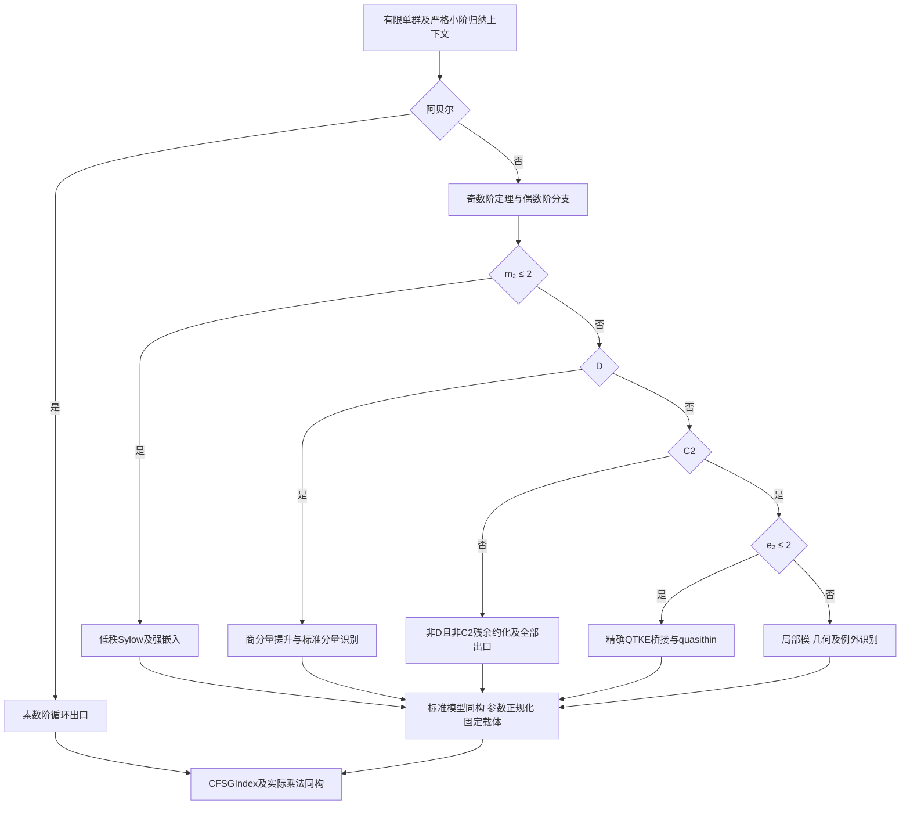

# 通过智能体协作完成 CFSG 的 Lean 形式化：完整实施方案

版本：2026-11-11；状态：完整规划稿 v1，供资源配置与实施评审。本轮完成规划、来源核对和设计一致性检查，未实施整个 CFSG，未运行 Lean。

本项目接受“完整 CFSG 的 Lean 形式化已经公开存在，因此任务可行”作为既定前提。实施采用**审计后复用优先、缺口自主重建**：智能体取得、理解、审计和迁移已有证明，建设缺失理论，证明到固定 TauCeti 群载体的同构，最终在锁定环境中完成全分类及名单正确性。人类提供设施、资料、算力和稀缺专业裁决，智能体承担日常数学与证明工程的主体工作。

建议从 **64 个并发智能体槽**开始，按深样本与真实集成产能扩展至 **256 槽：24 个八席数学编队加 64 槽共享服务**，必要时再试 512。先导窗口建议为 90 天，成熟期人类支持约 20 FTE。这些都是待试验的配置，不是已获得资源或产能事实。公开发布所述“数学家与工程师协调数十 agents、约 24 天”说明已有完成事件；它不披露内部流程，也不保证本项目在任何基线下复现同一工期。旧稿的 15–25 年及数百人年估算不沿用为本项目预测。

## 1. 固定交付：证明什么、怎样才算完成

保持 `sources/` 对应版本中的 `TauCeti.CFSGIndex`、`Valid`、`CFSGIndex.Group` 及其传递定义不变，新增 `FullCFSG` 证明层。目标源码见 [Classification.lean](sources/TauCeti/GroupTheory/SpecificGroups/CFSG/Classification.lean)：

```lean
-- 现有源码中的目标定义。
def ClassificationStatement : Prop :=
  ∀ (G : Type u) [Group G] [Finite G] [IsSimpleGroup G],
    ∃ i : CFSGIndex, Nonempty (G ≃* i.Group)
```

未来实现接口如下；此处是规格，尚未 elaboration：

```lean
-- 定理名为未来实现建议。
theorem FullCFSG.classification_zero : TauCeti.ClassificationStatement.{0}
theorem FullCFSG.classification : TauCeti.ClassificationStatement.{u}
```

第二条通过已有 `TauCeti.classificationStatement_of_zero` 完成宇宙运输。此外必须交付每个 `i : TauCeti.CFSGIndex` 的 `Finite i.Group` 和 `IsSimpleGroup i.Group`，以及所有分类出口到这些具体载体的乘法同构、参数合法性和被剔除重复项的必要小同构。目标只要求存在同构，不要求任意有限群的可执行识别算法。全列表两两不同构可另立扩展项目，不能替代上述必交付。

验收由四条链同时闭合：任意有限单群的穷尽分类链；局部识别到标准模型再到固定载体的同构链；全名单有限、非平凡、单性的正确性链；从全部根声明到锁定源码、公理与计算证书的可重放依赖链。没有 `sorry`、额外数学公理、隐藏的最终分类假设或未检证计算。只输出群名、群阶、带未提供前提的条件定理或“所有 K-proper 群已经分类”不能完成项目。

若固定定义被证实与数学对象不符，提交精确差异、反例及修复建议；继续其他分支，但在正式解决前不对现行目标宣布完成。既定可行性不是任意载体定义正确性的证明。

## 2. 从上一轮继承什么，本轮改变什么

| 项目 | 本轮决定 |
| --- | --- |
| 数学目标与具体列表 | 原样保留，并保留全名单有限单性、出口同构及证明可信性要求 |
| 原 50 个数学/工程父工作包 | 全部继承；保留原验收文本与参考依赖，转成由智能体编队执行的工作账本 |
| 原始数学路线 | 保留为自主重建的全覆盖后备骨架；允许根据实际可复用证明改选等价路线，须保持全部出口和覆盖证明 |
| 已公开完成项目 | 未来主动请求完整源码、blueprint、工具链和许可，按声明闭包审计后复用；不再永久排除其实现 |
| 复用粒度 | 基础引理、通用桥、重型中间定理及模块均可；不要求独立重新发现所有数学证明 |
| 最终装配 | 本项目显式消去前提、证明固定载体同构并装配目标，不以一行导入外部最终 CFSG 掩盖这些义务 |
| 组织与工期 | 智能体主导、并发试验、动态编队和闭合义务计量；不继承旧稿人力年限，不承诺 24 天 |
| 前轮未落盘同伴稿 | 未读取、未作为证据；本轮重新组织三份审阅，均实际保存 |

复用一个深定理不等于黑箱：必须取得完整证明源码及其传递闭包，核对假设、定义、许可、来源与公理，能独立重放，且不通过最终 CFSG 或未独立证明的推论形成回边。可把参考实现的大型子图整体移入隔离区，再逐声明映射、适配和验收；无需人为拆成手工重写。编译通过并不自动证明该定理适合当前归纳上下文。

为每个父包建立四路选择：R0 原基线已有且验证可用；R1 公开实现可审计迁移；R2 文献已有而需智能体形式化；R3 必须研究新接口、桥接或计算证书。优先 R0→R1，再比较 R2/R3 的成本与关键路径。若完整参考材料无法取得，R2/R3 路径继续，余量与预算重新评估。未知材料不会被记为已读或已验证。

## 3. 当前来源证据与未来资料获取

Mathlib 固定为 `b63f6e8a68d220e3b3bc4f3792bb53650d375f24`，TauCeti 固定为 `6e0c6acab5f4c6f42e5f5bab9bd5e4e84f74c380`。参考完成项目的提供标识为 `5437cdc31389dd9aeaa5c2a9465a4e164f8dea33`；本地只有其依赖 manifest 与书目，未提供完整实现、blueprint 或组织记录。`fixedToolchain: false`，不能从传递依赖 `inputRev` 猜 Lean 版本。

本轮可检查 90 份 Lean 源码及来源 hash、9,160 条 Mathlib 路径和 720 条书目。路径存在不等于定理充分；书目存在不等于已读取正文；已有呈示不等于有限单群。正文检查确认 `Classification.lean` 定义目标而未证明它；A/C/B₂/Suzuki 专门文件已有实质比较，Fi₂₄′ 已有到源呈示导群的同构，均优先重放。不能仅凭总装旧注释重建已经存在的比较。

采用证据标签 S（正文相关定义/证明）、P（仅路径）、M（数学规格/提议）、V（锁定环境已验证），另给来源命题“全文核对/待核对”状态。当前新增证明全为 M；本轮源码最多 S。本轮未读取论文正文、未读取完整参考实现、未执行 Lean，设计检查不提升这些状态。

首批资料请求包括完整固定仓库与工具链、`FixedPointCandidate`、`GroupPresentation`、`IsSimpleGroup` 等底层定义及全导入闭包；参考项目完整源与可取得的 blueprint；GLS 相关卷、奇数阶、低秩、signalizer、quasithin、Lie/几何与散在构造及勘误全文。书目键与固定群文件的 `sourceLocator` 作为检索入口，由代理逐页核对命题、前提、例外和引用祖先。

## 4. 数学主线与全任务覆盖

### 4.1 归纳上下文先建成公共设施

定义 `Listed(S)` 为存在固定 `CFSGIndex i` 及 `S ≃* i.Group`。`Section(H,S)` 记录子群 A、正规子群 N 和 `S ≃* A/N`。`KGroup(H)` 表示组成因子均 Listed，并证明组成列选择无关；`KProper(G)` 表示真子群均为 K-group。文献若需要更强的 section 条件，另立精确谓词。

对 `Nat.card G` 强归纳。真子群 H 的任一简单组成因子 S 满足 `|S| ≤ |H| < |G|`，因此归纳假设提供 Listed(S)。建议以明确的 `SmallSimple(G)` 接口携带“所有严格小阶有限单群已列出”的上下文，局部分支调用时提交严格阶界。不能从 K-group 直接推出其任意子群也是 K-group，不能对可能比 G 更大的 `Aut(S)` 直接使用小阶归纳。F00/I00 提供归纳框架，Z00 提供深分类，Z01 才消去 K 假设，禁止反向导入。

阿贝尔有限单群输出素数阶 `Multiplicative (ZMod p)`。非阿贝尔奇数阶分支由完整形式化的奇数阶定理排除；若引用更强局部结论，其证明也进入闭包。不能预设 involution 存在。

### 4.2 复用路线与自主路线共用出口契约

先取得参考项目的真实声明图和数学路线，再映射到同一组目标义务。若其路线与旧稿不同，以已审计的证明覆盖替换相应父包内部设计，提交旧/新覆盖矩阵及实际消费者证明；原义务不能因改名消失。参考路线未知时，按下述自主骨架并行准备文献和接口。

令 m₂ 为初等阿贝尔 2 子群最大秩；D 表示某 involution 中心化子之奇核商有非平凡 layer；C2 表示每个非平凡 2 子群 Q 的正规化子 M 满足 `C_M(O₂(M)) ≤ O₂(M)`；e₂ 为 2-local 中奇素数初等阿贝尔子群秩的最大值（空集取 0）。这些是未来精确定义，须证明最大值存在。



布尔分支穷尽只是 D00 的逻辑覆盖，不是 D01 的深桥接证明。D 与文献 component-type 不是未经证明的同义词；`¬D ⇒ C2` 不作先验；`C2 ∧ e₂≤2` 不直接当 QTKE。T07 残余可产生参数族或多层约化，不能预先限定为有限孤立例外。每个桥接要有准确来源/参考声明、翻译证明、参数例外、允许归纳调用和最终出口。桥接不成立时，增加显式子分支或换约化路线，不能删去残余。

### 4.3 50 个父包的执行责任

全部原父包、参考依赖、原验收与本轮补充见 [agentic-workplan.json](design/agentic-workplan.json)。下表是端到端责任索引，包含全部 50 个 ID；发布时每个父包须拆成无开放叶子的实际声明图。

| 父包 | 智能体主要交付 |
| --- | --- |
| E00–E01 | 锁定、来源及定义审计；声明/公理图；证书与构建服务；独立重放 |
| F00–F04、I00 | section、严格阶界、K语义；p-core、Fitting/layer、互素作用、transfer/fusion 与归纳基础 |
| R00–R02 | 普通/模角色论、blocks、所需扩张/乘子；被调用的具体计算均有证明 |
| O00–O02 | 奇数阶极小反例、局部结构、特征标与数论、完整定理及被调用强结论 |
| A00–A02 | 根群关系、生成与pinning；保Steinberg比较；有限固定点、导群中心商、BN-pair与阶/单性工具 |
| C00、L01–L05、N00 | 循环/交错与全部17 Lie构造子；标准模型到固定载体；小参数与重复项正规化 |
| S00–S07 | 呈示/证书通用层；全部26散在群模型、局部识别和固定呈示双向同构；Monster独立路线 |
| K00 | 按实际调用的 family×property×parameter-region 证明局部结构、Aut/Out、乘子、融合和相关模 |
| T00–T02 | 低2秩全部允许Sylow形状；强嵌入；可解及所需非可解signalizer |
| T03–T06 | 商分量提升、平衡、标准分量及非标准例外；交错/经典/例外Lie/散在分量识别 |
| T07 | `¬D∧¬C2` 残余的规格、局部约化、分支、出口及覆盖，允许完整参数族 |
| T08–T11 | pushing-up、局部模、quasithin/QTKE两部分接口、高宽几何、amalgam核与散在例外 |
| D00–D01 | 逻辑覆盖、真实文献/实现假设桥接、跨分支例外闭合 |
| Z00–Z02 | 深分类总装、阶归纳消去条件、全宇宙固定目标、全名单正确性与发布审计 |

原父包 DAG 是交付参考图，不作为全父包完成后才允许消费者动工的运行时屏障。K00 拆成细表项，T 包仅等待自己所需且已验收的表项；A00–A02 按族及公共桥分层，N00 按每个小同构释放。不让所有低秩工作等待 Monster 完成。粗参考图无环不证明未来细图无环；实现时同时检查声明依赖、条件依赖和数学来源中的隐藏循环。

重型包统一拆为 `spec / source / local / reduction / cases / exit / cover`：先固定规格与来源，再证明局部引理和约化，各分支给同构出口，最后证明覆盖与总装。T03 单列商分量的真实提升；T09 单列 strongly quasithin 与 QTKE 的定义翻译、两卷接口和异常；T10 单列几何连通/单连通、completion 到 G 的满射及中心核控制。只得到几何、满射或抽象群名不能关闭出口。

## 5. 固定名单的全部载体工作

### 5.1 17 个 Lie 构造子

| 执行包 | 精确构造子 | 证明与适配重点 |
| --- | --- | --- |
| L01 | A、twistedA、C | 复用已有SL/Sp比较，建立PSL/PSU/PSp有限单性与参数；unitary小域q与实现q²区别 |
| L02 | B、D、twistedD | B₂已有spin比较；一般spin、坏特征、正交型/中心商与域下降 |
| L03 | E6、E7、E8、F4、G2 | 具体表示与根群生成、Frobenius、标准模型、中心和小参数 |
| L04 | twistedE6、trialityD4 | 正确图作用载体；完整模型比较；triality实现q³不改变列表小域参数 |
| L05 | suzuki、reeG2、reeF4、tits | 半Frobenius与有限性、Ree/Suzuki识别；Tits须精确处理²F₄(2)′ |

按源码 `Valid` 逐条覆盖全部合法参数；不能以若干域大小试验代替全族。已有 A/C/B₂/Suzuki 的保根/保映射声明先重放并适配，避免重复发明。

统一桥先核对 `FixedPointCandidate` 的底层定义。预期是 H=Fix(F)、D=H′ 后的 D/Z(D)，不能静默替换为 H/Z(H) 或 (H/Z(H))′。保 F 的 ambient `MulEquiv` 依次运输固定点、导群、中心和商。简单正根公式需要完整生成性才能推到全群。有限性由合适 Frobenius 幂次/半Frobenius平方、有限域下降和忠实有限维表示等真实证明提供，固定点符号本身不够。

N00 必须把 A₁(4)、A₁(5) 送 A₅，A₁(9) 送 A₆，A₂(2) 送 A₁(7)，A₃(2) 送 A₈，B₂(3) 送 ²A₃(2)。另处理 B₂=C₂、偶特征 B=C、D₃=A₃ 和实际出口需要的低秩同构；B₂(2)′→A₆、G₂(2)′→²A₂(3)、²G₂(3)′→A₁(8)、²F₄(2)′→Tits。²B₂(2) 的导群中心商会退化，不能放回有效 Suzuki 索引。每条都交付真正同构与合法索引，而非注释或阶相等。

### 5.2 全部 26 个散在群

| 执行包 | 名字 | 首选模型/独立风险 |
| --- | --- | --- |
| S01 | M11、M12、M22、M23、M24 | 置换、Witt设计/Golay码、稳定子链 |
| S02 | J1、J2、J3、J4 | 四群分别选择有限模型、构造与识别，不能统一略过 |
| S03 | Co1、Co2、Co3、Suz | Leech格/有限几何；覆盖群与中心商区别 |
| S04 | HS、McL、He、Ru、ONan、Ly | 图、设计、有限模或局部构造，逐群局部唯一性 |
| S05 | Fi22、Fi23、Fi24Prime | 三换位与扩张，Fi₂₄及Fi₂₄′精确区分 |
| S06 | HN、Th、B | 独立模型、involution中心化子识别，覆盖和中心 |
| S07 | M | Monster有限模型、局部唯一性、Y₄₄₃中心核及80关系呈示桥 |

每群四类卡分别完成：独立模型 X 的有限/非平凡/单性及实际所需结构；局部分支 `G ≃* X`；固定呈示 P 的关系与生成给满射 P→X；规范形、阶上界、核消失或逆映射给 `P ≃* X`，最后复合到固定 `.Group`。呈示有限条不代表群有限，关系成立与满射只有一个方向。

小中型群可用经证明健全的BSGS、陪集与重写证书。外部GAP/Magma负责生成而非担保结果。Monster不以全元素或巨型最小置换枚举作为默认策略：优先复用可审计的结构证明，缺口用局部几何/中心扩张路线。已有Fi₂₄′重写到源呈示导群的同构、Monster到Coxeter附加关系呈示的比较保留复用；它们不自动给有限单性。Monster的79关系阶段与 M×2、加入中心关系后的80关系必须证明精确中心和核，不能混淆。S07在先导期即启动来源/深样本审计，不等其他25群完成才发现缺口。

## 6. 智能体组织、权限与人类支持

256槽常态：共享基础/归纳3队24槽，表示/奇数阶4队32槽，Lie4队32槽，散在4队32槽，低秩/signalizer/分量4队32槽，特征2/quasithin/几何4队32槽，路由总装1队8槽，共24队192槽。K00表项由有关模型队生产，局部队作为消费者，避免另设重复全集团队。

每个八席编队：数学规划1、文献/复用1、证明实施3、接口工程1、对抗审阅1、集成1。共享64槽为调度/依赖图8、检索12、编译/性能12、证书/工具8、独立审计16、记忆/交接/发布8。先导为6个八席队加16共享槽，共64。槽是进程并发容量，不等于人员、GPU或持续满负荷；模型实例轮换，责任和记忆持久保存。

智能体自主分解任务、查资料、写证明、运行编译、重试、请求细卡和在授权预算内调度。普通卡经独立代理审阅、CI和消费者通过后自动合并，无需人类逐张批准。公共定义/高影响假设由跨域接口组评议；最终目标与载体冻结。作者不能给自己唯一验收，集成员不能以自己写的测试作为唯一证据，独立审计槽不因赶工撤销。

成熟期请求20人全职等效支持：8名有限群/角色论/局部/几何/Lie/散在专家、4名Lean证明工程专家、3名设施工具工程师、2名文献数据专员、2名独立审计、1名资源负责人。先导8–12 FTE并配外部专家值班。人类重点审阅关键定义、重型接口、隐藏循环、路线切换和根定理，处理代理无法解出的精确问题；数学证明仍须由代理实现并经kernel核验。人类不是海量基础卡的审批串行瓶颈。

仓库按领域工作树隔离，上游源码只读，发布机器人独占主干写权限。代理读已授权资料、写自己的分支；采购、预算提升与对外联系由资源负责人落实。人类为未来项目提供权限与资源的请求写入资源单，不把本轮规划转成反复征询确认。

## 7. 任务协议与协作流水线

工作分三层：父包明确完整数学交付；定理卡明确一个可审阅的精确接口与消费者；尝试明确一次模型/策略/预算。推荐卡在1–3个代理工作日内给出可审阅结果，更大则拆解，不可通过增加未证假设缩小工作。所有角色使用同一账本，不把聊天总结当完成凭证。

每张卡必须有：ID/修订、完整Lean命题与宇宙/实例/隐含参数、定义与环境摘要、参数/例外、允许归纳、前置声明及版本、文献版本页码与勘误或复用源码定位、源码/许可证、负责人/独立审阅人/真实消费者、验证报告、资源预算、失败与交接索引。命题源码须保留，不能只存pretty-print或hash。

状态为 `proposed → specified → ready → leased → candidate → kernel_passed → independently_reviewed → consumer_integrated → released`，并有blocked/superseded/quarantined等分支。ready要求前置证明已可用，未就绪卡可以做来源与接口研究。父卡只在所有必要子义务和总装关闭后完成。任何前提或出口变化生成新修订，旧版绿色日志不继承。

一次闭环为：消费者提交准确需求→检索基线/参考实现/文献→规划员定规格与子卡→实施员在隔离环境搜索和编译→接口员运输→独立代理审查命题及闭包→构建服务重放→真实消费者使用→合并。编译诊断区分API/实例、缺引理、数学缺口和资源问题，不让通用模型无限修同一错误。

租约建议30分钟、5分钟心跳；认领使用比较并交换和单调世代号，过期进程不得覆盖新负责人。每个竞争尝试有独立ID，事件幂等，崩溃回收不丢工件。交接包保存最后可编译提交、有效patch、已证子目标、最小错误重现、失败策略及预算、未证步骤、允许依赖和下一项区分性实验；接手先重放。公共状态不依赖模型记住上一轮对话。

维护事实、数学来源、策略/负面结果、决策四类记忆。任务上下文按卡检索装配，不反复发送全仓全书。失败缓存绑定完整目标、实例/宇宙、环境和策略；未搜索到不是不可证明。PDF/OCR和代码注释只是资料，关键公式对照原页复核，不能改变系统指令或事实状态。

## 8. 调度、工具与失败处理

维护发布证明图与研究选择图：前者只存真实声明/已满足条件，后者允许候选路线、猜想和成本区间。已完成的父包参考依赖不等于细卡依赖；运行时只订阅所需的实际声明。优先级综合关键路径、解锁消费者、减少路线不确定性、共享复用价值及预计代理时；周度重排，日度报告未覆盖分支和人工/构建排队。

初始运行时预算65%用于主线实现集成、15%用于不同策略竞争、10%工具/API、10%独立核验；这与角色编制是同一资源的不同视角，不重复加槽。默认至多三种有实质差别的策略：复用适配、文献直证、改变中间表示。成功后终止无必要重复，保留有价值的独立审计。每队在制实现卡不超过实施槽两倍，消费者滚动提交两周需求单。

建设声明类型/定义/依赖/公理检索、Lean语言服务器与最小目标服务、隔离Git工作树、内容寻址构建、证书库、事件账本、度量与重放服务。编译分编辑反馈、卡/消费者集成、包/发布冷重放三层。缓存键包含工具链、依赖提交、源码、选项、证书和检查器。规格/候选区可有洞但物理隔离；发布闭包不能导入未完成声明。基础API可上游，锁定兼容层保证项目不被上游合并节奏阻塞。

| 触发 | 处置与保持的义务 |
| --- | --- |
| 同一错误三轮或30分钟无新信息 | 最小重现，转接口专家，显式运输或改表示；原目标不变 |
| 单卡用完预算/三路线失败 | 停同质重试，拆缺引理，重新检索，提交精确专家问题；继续未完成 |
| 文献多出K/参数等前提 | 修改中间规格、证明前提或补分支；重新核对路由 |
| 复用闭包依赖总CFSG/未经批准公理 | 隔离该部分，取独立子模块或重建；缺口仍记账 |
| 一周重型路线不降低不确定性 | 两队做路线对照，专家评议切换，保留已证基础 |
| 呈示只有满射/Monster枚举爆炸 | 转核、阶界、规范形、局部几何或结构证明；不宣布同构 |
| 证书重放超资源 | 分块、优化已证checker、调配设施；不静默扩TCB |
| 公共API/规格错误已合并 | 撤销凭据、隔离反向依赖、回滚或迁移，修后重新验收 |
| 来源/许可不足 | 资源负责人获取或换合法来源，代理做独立重建；不猜全文 |

专家升级单必须包含完整命题、当前前提、已尝试路线、反例/计算范围、精确待答问题及来源页。专家建议形成新卡或映射记录，不能替代证明。高风险单点至少双责任人，轮换交接可接续。

## 9. 设施和资源请求

立项请求人类落实五类设施，并给每类指定责任人与交付日期：完整源码/工具链/许可；可检索全文、扫描与勘误；模型端点和吞吐配额；构建/检查/证书/存储平台；专业协作与独立审计。当前房间无Lean、网络/PDF缺失、四席和shell时限不构成未来项目固有限制。

64槽先导起配8台32核/128GB构建节点、20TB存储、代理沙箱/索引和独立冷重放机。256槽常态可预留512 vCPU/2TB代理沙箱，另32台64核构建节点；若每台256GB为8TB，其中4台升到1TB则总约11TB。另按需启用4台64核/512GB–1TB证书节点，两处独立冷重放环境，初始100TB版本化对象存储与NVMe缓存。全部为采购起点，按实测队列/峰值扩缩，不是已验证需求。

模型服务要按聚合token/s、并发和尾延迟申请，不能只买会话数。推理可API或自托管，按实测质量与总成本比较；不默认需要巨型GPU训练集群，自建推理与API费用互斥核算。GAP/Magma/Sage可用于探索和证书生成，许可证由人类落实。

预留文献/源码镜像、来源索引、关键页双人核对服务、每日备份与恢复演练；最终发布源码/证书及来源元数据，受许可资料按访问规则保存。先导期未交付的资源明确列缺项，换路线或调整安排，不伪造可用性。

## 10. 首90天与全任务阶段门

| 时间窗口 | 智能体任务与可核验出口 |
| --- | --- |
| 第1–7天 | 取得完整环境与实际工具链；两处基线重建；目标/传递定义锁定；完整参考源码及许可获取表；启动任务/检索/构建服务 |
| 第8–21天 | 64槽协作闭环；循环与A₅出口；一模块从复用到固定消费者；A₁(7)固定点载体桥样本；租约/交接/失败回放 |
| 第22–45天 | 深样本：section归纳、Lie桥、M11双向呈示、奇数阶、分量/K表、QTKE/几何；至少两项重型模块闭包审计和适配试验；Monster独立深样本 |
| 第46–60天 | 分层匹配的任务池测16/32/64及候选128槽；比较复用与重建，测消费者产能、返工、语义缺陷、人工等待和编译瓶颈 |
| 第61–90天 | 达标扩128/256；所有50父包、路由叶子、17+26名单均有队伍和复用/缺口路径；给剩余声明图、关键路径区间、下一阶段资源与预算 |

日期是计划窗口，未保证样本全部按时证明。失败样本须给可复现缺口及能改变决策的信息。若可靠复用足够，阶段可提前；若前提/桥接缺口大，继续攻坚并滚动测算，不把可行性重新当立项问题。

| 门 | 必须满足的证据 | 失败后的动作 |
| --- | --- | --- |
| M0 环境/目标 | 工具链、依赖与定义锁定，两处基线构建、初始公理报告 | 补设施或隔离环境问题，其他文献/接口工作继续 |
| M1 复用/缺口 | 50父包与全部路由/名单有来源、负责人和精确缺口；参考模块闭包评估 | 对问题子图改走重建，修正关键路径 |
| M2 垂直出口 | 归纳基础、循环/交错、至少一Lie和一散在的具体同构消费者闭合 | 保留成功链，修接口/证书/参数，不用短引理充数 |
| M3 重型平台 | 实际调用的奇数阶、signalizer、分量、模/特征2/quasithin/几何有完整闭包 | 隔离未证前提/异常，增补子卡或切路线 |
| M4 全任务 | 所有路由、K消去、17+26有限单性、呈示和模型桥，根目标及宇宙运输通过 | 只报告已证范围，保持未闭合根不得发布 |
| M5 独立发布 | 两处干净重建、全部根类型/公理/定义闭包、证书/性能/来源审计通过 | 回滚到有效里程碑，修后重新验收 |

M0–M5是依赖门而非六个顺序日历阶段。可并行推进M3模块和M2出口，最后由真实闭包收口。

## 11. 产能试验、扩容和成本

核心产能是**净消费者集成卡**：首次通过真实消费者、独立审阅和kernel检查计一次；重复证明不重复计，撤销扣回。按API/运输、复用适配、文献重建、重型桥、证书分层报告代理时、美元、人工时、首次消费者成功率、7/30日返工率、构建延迟和剩余父义务。冻结抽样命题与粒度，不能把rfl拆卡制造增长。

先导抽60–100张预审卡，至少三分之一跨模型/跨领域或重型接口；包含奇数阶、QTKE及Monster深样本。匹配不同任务池做并发对照，固定模型/工具，保留全部失败，不把同题热启动当扩容收益。小引理及M11高吞吐不能外推Monster或全CFSG。

初始扩容阈值：消费者成功率≥80%、7日返工≤10%、所有采纳结果符合信任政策；从N到2N槽净吞吐至少1.5倍、单位成本增幅≤25%；人工与构建队列能承受，且就绪任务足够。这些是可修订的管理阈值，语义/证明缺陷不因指标好看而放行。

令某类卡平均每次尝试耗 b 代理时，形成待审候选平均需 a 次尝试，独立审阅/消费者保留率 q，后续返工折减 v，则该类净吞吐约为 `分配活跃代理时 × q × (1-v)/(a×b)`。实际受就绪任务、构建、人工与集成服务率共同限制。工期至少取剩余工作量/实测产能、顺序关键路径、稀缺审阅、最终重放四个下界，用真实DAG与耗时分布按月更新，尚无数据不给伪精确完成日期。

成本按实际模型输入/输出token与价格加总，缓存/重试/计费推理如实计入；不对同一服务再按槽日重复收费。仅作现金规划的假设：每百万输入token 5美元、输出25美元；活跃槽日输入600万、输出80万，约50美元。256槽利用率0.65、30日模型费约249,600美元/月。64槽同口径约62,400美元/月。该价格不是任何厂商报价。

| 256槽稳态费用假设 | 美元/月 |
| --- | --- |
| 模型服务 | 249,600 |
| 构建/沙箱/存储/证书设施 | 50,000–150,000 |
| 20 FTE，年全负担25–40万美元/人 | 416,667–666,667 |
| 加20%储备的合计 | 859,520–1,279,520 |

6/12/24个月在同一稳态下分别约516–768万、1,031–1,535万、2,063–3,071万美元，**仅是费用敏感性情境，不是本项目工期预测**。模型费另做0.25/1/4倍敏感性；一次性资料/迁移/专用开发单列。先导采用64槽及8–12人，后期关停闲置编队，真实费用按爬坡积分，不按稳态全程收费。每次扩容给边际费用、净集成收益和关键路径影响；人类资源负责人按具体结果分阶段拨款。

## 12. 可信证明与最终发布

最终声明的实际 elaborated 类型必须与固定目标一致：核对所有隐含参数、typeclass、宇宙、section变量，防止多出分类前提。名单有限性/单性根逐项获取传递公理闭包，核心公理按精确声明身份白名单审阅，常见允许项为 `propext`、`Classical.choice`、`Quot.sound`；禁止新增数学公理、`sorryAx`及改名分类假设。源码grep和`#print axioms`各只能覆盖部分问题，后者不能发现全部条件/语义循环。

审计固定定义的传递闭包，而非只锁Classification文本；检查宏/插件/原生求值/`implemented_by`/unsafe/FFI对可信边界的影响。默认采用kernel可重放证明或已证健全checker；`native_decide`不能未经核查进入发布。外部计算输出仅在证书健全性、实际数据验证和资源可重放都通过后使用。证书格式、生成器版本、checker证明、数据hash、分块顺序和峰值检查资源入档。

发布从锁定源码重建，不依赖未经核实的下载`.olean`；两处独立环境不共用开发缓存作为唯一证据。归档准确工具链、依赖提交、源码/证书hash、镜像摘要、完整构建命令、定义/声明/公理图、来源与许可、全部根声明、两处日志及耗时/内存。独立重建验证工程与环境一致性，语义审阅验证目标与数学含义，二者不可相互替代。

建议未来实现仓库分 `FullCFSG/{Foundations,Representation,Lie,Sporadic,KnownFamilies,OddOrder,Local,Component,CharacteristicTwo,Quasithin,Induction,Target}`，另设Contracts/Blueprint/Certificates/Audit和编排服务。上述为未来结构，本轮没有伪造Lean实现目录或编译日志。

## 13. 本轮实际交付与检查范围

本轮实际文件清单如下；`previous/`和`sources/`作为原始输入保留不改。

| 路径 | 内容 |
| --- | --- |
| [AGENTIC_PLAN.zh-CN.md](AGENTIC_PLAN.zh-CN.md) | 本轮完整主方案 |
| [design/agentic-workplan.json](design/agentic-workplan.json) | 50父包及24编队、职责、复用顺序、细化调度、17/26精确覆盖 |
| [design/validate_agentic_plan.py](design/validate_agentic_plan.py) | 本轮布局下的设计一致性和来源hash检查器 |
| [design/validation-report.json](design/validation-report.json) | 检查器实际运行报告；仅设计记账/来源范围 |
| [reviews/MATH_REVIEW.zh-CN.md](reviews/MATH_REVIEW.zh-CN.md) | 本轮重新完成的数学路线/复用独立审阅 |
| [reviews/OPERATING_MODEL.zh-CN.md](reviews/OPERATING_MODEL.zh-CN.md) | 组织、任务协议、设施、调度和可复算产能/成本详稿 |
| [reviews/ASSURANCE.zh-CN.md](reviews/ASSURANCE.zh-CN.md) | 本轮独立可信性与完整性审阅，含其实际审阅范围 |

复核命令（工作目录 `/work`）：

```sh
python3 design/validate_agentic_plan.py
```

该脚本核对50父包原记录/参考DAG、17 Lie与26散在源枚举覆盖、90份来源字节/hash、编制算术与实际交付存在性。它不验证数学路线正确、未来声明级图无环、Lean可编译或估计产能真实。上一轮归档脚本的相对路径不适合当前目录布局，本轮独立脚本与报告不覆写旧记录。三份新审阅不冒称前轮未落盘稿。

未来项目启动即可按M0资源单建设设施，由64槽完成复用映射和深样本，按消费者产能扩编，以全部路由、归纳、载体同构和依赖闭包逐项关闭整个CFSG任务。完整数学证明的发布门槛始终是M5，当前规划交付不等于CFSG已在本房间重新证明。
