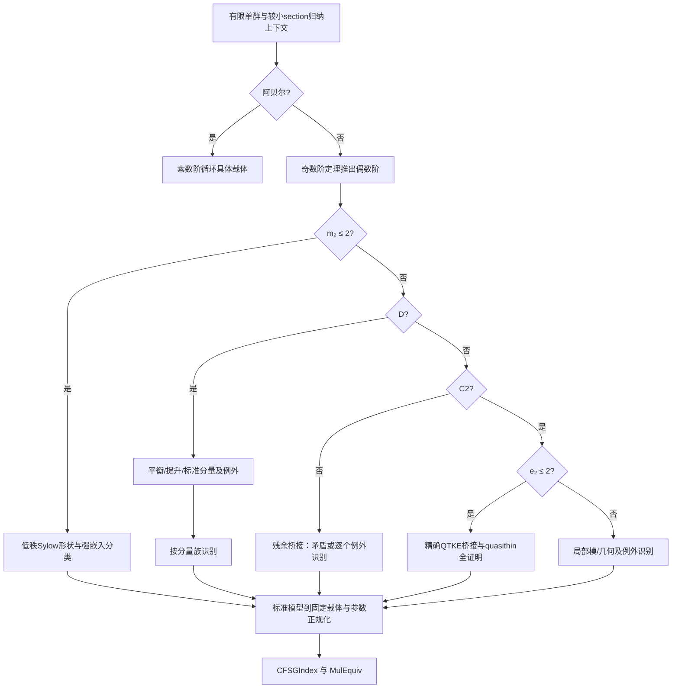

# 全有限单群分类 Lean 形式化：项目设计提案

版本：2026-11-11；状态：供立项与数学、工程评审的设计，尚非经过编译的 blueprint。

本项目从指定 Mathlib/TauCeti 基线出发，重新开发完整 CFSG 证明及其支撑理论，最终证明固定的 `TauCeti.ClassificationStatement`，并把识别结论落实到固定列表的具体群。建议先投入 90 天、12 名全职等效人员的先导期；长期按数百至上千人年的研究工程安排，分阶段拨款。核心交付包括分类的穷尽性、列表载体的正确性、连接两者的同构，以及可独立重放的完整证明依赖。

本轮只完成项目设计。没有运行 Lean，没有读取论文正文，没有使用完整外部 CFSG 实现。下文将“已检查的源码”“只有路径的库存”“数学路线设计”和“未来验收条件”分开说明。

## 1. 成功的精确定义

### 1.1 固定目标

目标来自 `sources/TauCeti/GroupTheory/SpecificGroups/CFSG/Classification.lean:54`：

```lean
-- 以下是提供源码中的定义，不是本轮新增并检查的代码。
def ClassificationStatement : Prop :=
  ∀ (G : Type u) [Group G] [Finite G] [IsSimpleGroup G],
    ∃ i : CFSGIndex, Nonempty (G ≃* i.Group)
```

保持原文件、索引、参数有效性条件和 `i.Group` 的定义不变。新项目另设命名空间 `FullCFSG`，增加证明文件。最终声明的建议接口是：

```lean
-- 仅为未来接口规格；本环境未 elaboration。
theorem classification_zero : TauCeti.ClassificationStatement.{0}
theorem classification : TauCeti.ClassificationStatement.{u}
```

第二条使用源码已有的 `TauCeti.classificationStatement_of_zero`，不重新造一个宇宙层级版本。`Nonempty` 表示存在同构；项目不额外承诺可执行的任意有限群识别算法。

### 1.2 另外交付名单正确性

目标命题本身仅要求每个有限单群出现在列表中，并不要求每个列表项都是有限单群。为符合“完整 CFSG 及其具体列表”的数学含义，本项目还要求分别证明以下规格：

- 对每个 `i : TauCeti.CFSGIndex`，`Finite i.Group`。
- 对每个 `i`，`IsSimpleGroup i.Group`，包括非平凡性。
- 局部识别定理的每个结果均通过具体 `MulEquiv` 到达这些载体。
- 被固定索引剔除的重复代表，给出到保留代表的显式数学同构；不在归纳出口生成无效索引。

全列表两两不同构的完整定理不是固定命题的必要条件，单列为后续可选交付；不得因此省略出口所需的小同构。阶公式、外自同构、乘子、中心化子等只要被证明主线调用，就属于必交付支撑理论。

### 1.3 不得作为完成的替代品

不能以 `axiom CFSG`、未关闭的 `sorry`、假设“所有 K-proper 单群已经分类”、任意抽象 `KnownSimple` 标签、GAP/Magma 的无证书输出，或把最终分类从其他库整体导入来完成项目。允许阅读传统数学文献并重新形式化，允许复用经过审计的基础库证明。Axiom CFSG 完成项目的实现、blueprint 与组织方案没有提供，也不作为本设计的依据或未来证明依赖。

## 2. 当前证据与可复用基线

固定 Mathlib 提交为 `b63f6e8a68d220e3b3bc4f3792bb53650d375f24`，TauCeti 为 `6e0c6acab5f4c6f42e5f5bab9bd5e4e84f74c380`。`cfsg-dependency-manifest.json` 固定包修订，但 `fixedToolchain: false`；首阶段必须读取实际项目工具链文件并建立完整锁定，不能从某个传递依赖的 `inputRev` 猜 Lean 版本。

| 材料 | 本轮实际能确认 | 不能据此确认 |
| --- | --- | --- |
| `source-manifest.json` 与本地源码 | 90 份 Lean 源码可逐个核对字节数与 SHA-256，其中 Mathlib 4 份、TauCeti 86 份 | 完整导入闭包、公理依赖、编译状态 |
| `mathlib-paths.txt` | 9,160 条路径，包含 Sylow、Transfer、SchurZassenhaus、JordanHolder、Character、Alternating/Simple 等入口 | 相关定理足够强、API 可直接适配、CFSG 支撑理论已经存在 |
| 四份 Mathlib 正文 | Sylow API、交换子恒等式、导列与可解性、交错群的阶/生成/中心等具体源码 | `Alternating/Simple.lean` 的正文与定理；它没有随包提供 |
| `Classification.lean` | 具体列表到群载体的分派，命题定义，宇宙下降结果 | CFSG 证明、统一有限性与单性 |
| Lie 族装配及专门文件 | 具体 ambient carrier、Steinberg 映射、部分保根与保映射的比较源码 | 全族都已是标准简单群，或所有 pinning 比较都缺失 |
| 散在群文件 | 26 个具体呈示、转录检查及部分更强的呈示同构 | 呈示群必然有限、非平凡或单 |
| `bibliography.bib` | 720 个书目条目及其出版元数据 | 具体页码的命题内容、假设、勘误和证明闭合 |

特别注意：`Assembly/AmbientGroup.lean`、`Assembly/LieType.lean` 的总体说明仍提示尚缺与 pinned groups 的比较，但 A/C/B₂/Suzuki 专门文件已有相关比较源码。审计以具体声明与其依赖为准，不能只读总装注释就重复计划全部工作。

首轮基线审计采用四级状态：S＝正文有相关定义/证明；P＝只有路径；M＝数学上计划使用的定理；V＝在锁定环境中验证通过。目前提供源码最多记 S，库存仅记 P，所有新增工作包均是“提议、未验证”。

## 3. 证明的骨架：有限 section、阶归纳与具体出口

### 3.1 先固定语义

用下述数学规格描述接口，首阶段再选取与实际 Lean API 相符的编码：

- `Listed(S)`：存在固定 `CFSGIndex i` 及 `S ≃* i.Group`。
- `Section(H,S)`：有子群 `A ≤ H` 和正规子群 `N ◁ A`，以及 `S ≃* A/N`；记录同构而不依赖载体相等。
- `KGroup(H)`：H 的组成因子均满足 `Listed`；证明组成列选择无关。
- `KProper(G)`：每个真子群 H 的 `KGroup(H)`。

若某个文献定理需要“每个真 section 都是 K-group”等更强性质，则建立单独谓词并从归纳证明，不能在名字相近时强行当作同一假设。也不能从 `KGroup(H)` 直接推出 H 的任意子群是 K-group；已知简单族的子群本身可能需要分类结果才能处理。

### 3.2 明确怎样消去 K 假设

对 `n = Nat.card G` 强归纳。对真子群 `H < G`，其任一简单组成因子 S 满足：

```text
|S| ≤ |H| < |G|。
```

运输 `Finite`、群结构、单性后，归纳假设给 `Listed(S)`，于是 H 是 K-group。局部证明后来若需要 H 内任一简单 section，也直接用该 section 阶小于 G 的事实调用同一个归纳上下文；不偷用 K-group 对子群封闭。`F00/I00` 负责所有类型宇宙、正规商、严格阶界及同构运输。

此后调用一个最终须完全证明的 `classify_KProper_simple`，其输入为有限非阿贝尔单群、`KProper` 以及需要的较小 section 分类上下文，输出 `Listed(G)`。若其证明需要更强假设，必须写入接口，证明归纳能提供，再验收。

这里把这个总接口命名，是为了确定工程收口。它的证明必须由第 4—5 节所有分支组成，不能作为公理或未拆分的外部定理。`I00` 只做归纳基础设施；`Z00` 才做大型分类；两者不可互相导入。

### 3.3 边缘情况

阿贝尔有限单群由任一非单位元生成、其阶必为素数，构造到 `Multiplicative (ZMod p)` 的同构。平凡群由 `IsSimpleGroup` 的实际定义排除，并在基线审计时核对。非阿贝尔简单群的奇数阶分支由本项目形式化的奇数阶定理排除，不能把“有 involution”作为未证明的全局前提。

## 4. 选择的全覆盖数学路线

采用经典局部分析、分量理论和特征 2 型分析的组合路线。先用完全穷尽的原始谓词分派，再证明它们与具体文献定理的假设之间的桥接。这样即使术语或例外不同，也不会在流程图中丢掉一类群。

以下为设计中的数学定义，尚未在 Lean 中实现。对有限群 G：

- `m₂(G)`：初等阿贝尔 2 子群的最大秩。
- `D(G)`：存在 involution t，使 `E(C_G(t)/O_{2′}(C_G(t))) ≠ 1`。`E` 是 layer，`O_{2′}` 是最大奇阶正规子群。这里要求建立 quotient 与 layer 理论。
- `C2(G)`：对每个非平凡 2 子群 Q，令 `M=N_G(Q)`，有 `C_M(O₂(M)) ≤ O₂(M)`。
- `e₂(G)`：在所有 2-local 子群中出现的奇素数 p 的初等阿贝尔 p 子群最大秩；取不到时设为 0。2-local 指非平凡 2 子群的正规化子。必须先证最大值存在，不假设可执行枚举。



`D ∨ ¬D`、`C2 ∨ ¬C2` 仅给出逻辑划分。这里没有声称 `D` 就是任一出版物中的完整 component-type 假设，也没有声称 `¬D ⇒ C2`。`¬D ∧ ¬C2` 保留为必须处理的重型分支 `T07`。同样，`C2 ∧ e₂ ≤ 2` 与文献 strongly quasithin、QTKE 的关系，由 `T09/D01` 逐条证明；宽度、秩、例外及 K 假设均须核对。

先导期须核实这些原始划分足以通过计划桥接接上所选的标准分类定理。发现一个桥接不能成立时，允许增加其显式例外分支、加强中间结构、改用经核对的约化；最终固定目标不改，残余分支不能删。原始覆盖的逻辑正确性不等于这些深定理已经成立。

## 5. 重型数学工作怎样落地

机器可读账本 `design/obligations.json` 包含 50 个有负责人角色、前置依赖和验收条件的工作包。它是交付级 DAG，不是声称已穷尽所有引理的声明级依赖图。实施时每个重型包都必须再拆为可审阅的定理卡，且全部叶子都有负责人和证明来源。下面给出核心包的具体内容。

| 包 | 必须开发的内容与输出 | 验收时必须排除的漏洞 |
| --- | --- | --- |
| F00–F04 | section/组成列；p-core 与 π-core；Frattini/Fitting/layer；quasisimple 分量、subnormal 与中心积；互素作用；transfer、normal complement、fusion、strong closure | 群内子群与抽象群的混淆；K 对任意子群封闭；隐含全局分类 |
| R00 | 普通特征标正交性、不可约分解、代数整数、诱导/限制、Clifford 理论；所用 Frobenius 角色论 | 把一个 Character 文件当成整套 Feit–Thompson 特征标工具 |
| R01–R02 | 所调用的模表示、Brauer 角色、blocks/defect、局部模；扩张、H¹/H²、乘子与中央扩张 | 未证明的角色表、分解矩阵或 Schur 乘子表 |
| O00–O02 | 奇数阶极小非可解群；可解局部结构、Hall 系统、TI/Frobenius 构形；exceptional characters、诱导等距及数论；最后得到任意奇数阶有限群可解 | 只处理 odd simple 群而未证明被局部论证调用的强结论；直接引用另一个证明器的最终结果 |
| K00 | 已知族中实际需要的 involution 中心化子、局部子群、融合、Aut/Out、乘子和相关模，逐族证明 | 把 Schreier 猜想当作无条件先验；用 CFSG 才能证明的全局子群表倒灌主线 |
| T00 | 低 2 秩：循环、四元数、二面体、半二面体、wreathed 及其他被秩约束允许的 Sylow 情形；transfer/强嵌入与低秩结构定理；所得族逐个识别 | 只证明二面体 Sylow 分类就宣布 m₂≤2 完成；漏掉消除或归类某个 Sylow 形状 |
| T01–T02 | 可解 signalizer functor 的平衡与完备性；需要的非可解/K-group signalizer 版本；连接性与局部到全局控制 | 省略非可解版本，或把 theta-function 的取值假设写成结论 |
| T03 | 从 involution 中心化子的奇核商分量提升，balance、组件交换/覆盖控制，标准分量约化；每个不满足标准形的分支登记 | 将商中的分量直接当成原群子群；不证明存在标准分量 |
| T04–T06 | 标准分量按交错、经典、例外 Lie、散在族分表处理；逐个给生成、融合或几何重建；混合构形和小参数另列 | 用“标准分量定理”一个名字隐藏全部分类；只输出群名 |
| T07 | 在 `m₂≥3 ∧ ¬D ∧ ¬C2` 下，证明所选局部约化条件，输出矛盾或明确例外列表及其识别 | 将“没有分量”替换成“特征 2 型”，留下无去向的群 |
| T08 | 特征 2 型的 pushing-up、replacement、quadratic/FF 模、大 2 子群、parabolic 系统与 amalgam 局部控制 | 使用依赖总 CFSG 的现代局部定理却不重新证明其所需特例 |
| T09 | quasithin：第一部分局部结构与 strongly quasithin K-group 分析；第二部分简单 QTKE 识别；两部分之间所有定义与异常分支 | 只导入两卷主定理的名字；直接从一个宽度数值跳到 QTKE |
| T10 | 高宽度几何：秩 1/2 残余、building/parabolic 几何、连通与单连通、amalgam completion、Curtis–Tits/Phan 所需版本；识别 Lie 型 | 只构造几何而未证明全群同构；忽略 universal completion 的中心核 |
| T11 | 特征 2 型中几何主分支之外的散在及小参数构形，逐一局部识别 | 默认高宽度必然是 Lie 型；漏掉散在出口 |
| D00–D01 | 原始逻辑覆盖，文献定义翻译，跨分支例外闭合；对每个出口生成索引及参数合法性 | 将选定路线的未核对假设当作已证分派定理 |
| Z00–Z02 | 关闭 K-proper 分支分类，阶归纳消去假设，精确目标与全列表结构、公理闭包复核 | 条件分类被报告成无条件 CFSG |

不预设所有包彼此完全独立。K00 与信号函子、分量分析、quasithin 之间的接口尤其需要拆细：已知族结构层只能依赖直接构造、经典理论及已证明的较小定理。若其某个表项依赖主分类，该表项要改为独立证明，或将其所依赖的归纳阶界作为显式参数。声明级 DAG 出现环就是阻止验收的缺陷。

每张定理卡固定包含：完整假设/结论、所用群与 section、文献版本及实际页码、源码入口、全部子义务、参数范围、例外、允许的归纳调用、输出模型及载体桥、数学审阅人、Lean 审阅人、公理与资源报告。前置条件只能引用卡中已写出的定理。以卡为单位逐步扩大可用环境，不让所有团队 import 一个含任意假设的大文件。

## 6. Lie 型列表：17 个构造子的逐族义务

固定列表共有 9 个普通族、4 个图扭曲族、3 个 Suzuki–Ree 族和独立 Tits 项。所有普通及图扭曲参数 `q` 是小域参数；`twistedA r q` 的矩阵实现涉及 q² 域，triality 涉及 q³，不能把矩阵系数域大小当成列表参数。

### 6.1 已有比较与待完成矩阵

下表的“已有”均为所给源码中有相应声明，仍需完整导入环境复核。`Valid` 只是索引条件。

| 固定构造子 | 参数摘要 | 当前有据可用与未来责任 |
| --- | --- | --- |
| A | r≥1；r=1 时 q≥4；剔除重复 | A 型 `Agreement` 有保根、保 Steinberg 的 pinned SL 比较；L01 完成有限固定点、导群/中心、简单性和标准 PSL 识别 |
| twistedA | r≥2；r=2 时 q≥3 | 同一 A 型比较包含图自同构；L01 完成 unitary 下降、SU/PSU 识别 |
| B | r≥2；排除 B₂(2)、B₂(3) | B₂ 有 `SpinAgreement`；更高秩 spin 与 pinned 简单连通模型的比较及坏特征由 L02 承担 |
| C | r≥3；p≠2 | C 型 `Agreement` 已有 pinned Sp 比较；L01 完成 PSp 识别与结构 |
| D | r≥4 | spin 载体、Frobenius 有定义；L02 完成根群生成、pinning、正交/射影模型桥 |
| twistedD | r≥4 | 与 D 同属 spin 线，带叉节点图扭曲；L02 完成 minus-type/域下降与中心问题 |
| E6 | 全部素数幂 | 显式 minuscule 载体；L03 完成 simply connected 识别及中心商 |
| E7 | 全部素数幂 | 显式权表示载体与 Frobenius；L03 完成全模型比较及中心问题 |
| E8 | 全部素数幂 | 显式 unimodular/Geck 路线；L03 完成完整根群理论与标准识别 |
| F4 | 全部素数幂 | 同属普通例外线；L03 包括坏特征与生成/中心问题 |
| G2 | q≥3 | 同属普通例外线；L03 完成该范围单性；G₂(2) 导群另外正规化 |
| twistedE6 | 全部素数幂 | 源码另有适合图作用的载体，不能直接沿用 E₆ 的 27 维载体；L04 完成双重/完整模型比较 |
| trialityD4 | 全部素数幂 | D₄ tripled 载体与 triality 已构造；L04 完成根群/图作用/Steinberg 的全同构 |
| suzuki | q=2^(2m+1)，m≥1 | `Suzuki/Agreement` 与 `Candidate` 已有 pinned 比较和生成矩阵群同构；L05 仍负责完整有限单性及识别定理 |
| reeG2 | q=3^(2m+1)，m≥1 | 短根载体、半 Frobenius 有源码；L05 完成标准 Ree 识别、有限单性 |
| reeF4 | q=2^(2m+1)，m≥1 | 短根载体、半 Frobenius 有源码；L05 完成全部结构与识别 |
| tits | ²F₄(2)′ | 独立 index；L05 必须证明真正的导群及其单性，不能用“大域统一群已完美”覆盖 |

### 6.2 统一载体桥

`Assembly/LieType.lean` 的 `.Group` 是 `FixedPointCandidate d.steinberg`。本包未给出 `FixedPointCandidate` 定义所属文件的正文；所给族文件将其解释为“固定点群的导群，再商掉该导群的中心”。首阶段必须取得底层定义核对括号、子群嵌入和实例。以 `H = Fix(F)`、`D = H′` 表示，预期公式为 `D/Z(D)`；不能擅自替换成 `H/Z(H)` 或 `(H/Z(H))′`。

A00–A02 先建立通用传输定理：一个 ambient `MulEquiv`，加上 `e ∘ F = Fstd ∘ e`，诱导固定点同构，再诱导导群同构、中心同构与最后的商同构。根参数与 pinning 也随映射核对。只有简单正根上的公式，不足以自动推出整个群的等式；须证相关正负根群的生成。

有限性必须有独立证明。普通/图扭曲时，从合适幂次的 F 是 Frobenius，下降到有限系数域；半 Frobenius 时利用已构造的 `F² = Frob_q`，证明固定点进入有限矩阵集合。还需有限维表示的忠实性或足够的单射。之后证明阶、导群、中心、完美性及单性，精确处理小参数；固定点符号自身不提供任何有限性。

不要求为了形式化而先建完所有一般 reductive group 理论。优先为本项目所需的具体 Chevalley/经典模型和所需根关系建立足够理论；涉及固定 pinned 模型的比较必须真实完成。若某条证明采用一般定理，其依赖也进入账本，不能把一般理论默认当成免费基础。

### 6.3 参数正规化

N00 至少证明六个被剔除的重复代表：

| 原代表 | 固定列表保留的代表 |
| --- | --- |
| A₁(4)、A₁(5) | A₅ |
| A₁(9) | A₆ |
| A₂(2) | A₁(7) |
| A₃(2) | A₈ |
| B₂(3) | ²A₃(2) |

此外处理低秩命名 `B₂=C₂`、偶特征 `B_r=C_r`、D₃=A₃ 等必要出口，给出场同构与参数数据到 `PrimePower` 的运输。特别小群另证：B₂(2) 的导群对应 A₆；G₂(2) 的导群对应 ²A₂(3)；²G₂(3) 的导群对应 A₁(8)；²F₄(2) 的导群对应 Tits。²B₂(2) 的导群为五阶循环且其中心是自身，按候选商配方会退化，不能把它放回有效 Suzuki 索引。源码关于这些数学同构的注释或 `Valid` 的 example 并不等于已经证明同构。

## 7. 26 个散在群：构造、识别、固定呈示三层分开

| 包 | 精确覆盖的固定名字 | 首选数学模型与风险 |
| --- | --- | --- |
| S01 | M11、M12、M22、M23、M24 | 置换作用、Witt designs/Golay 码及 stabilizer 链；既证有限简单，也证局部刻画与呈示识别 |
| S02 | J1、J2、J3、J4 | 分别选择有限矩阵/置换/几何模型；四群分卡，不能以统一“Janko 构造”替代 |
| S03 | Co1、Co2、Co3、Suz | Leech 格/有限格几何与子群；Co₁ 的中心商及 Suz 的覆盖群必须分辨 |
| S04 | HS、McL、He、Ru、ONan、Ly | 图、设计、有限模或局部构造；逐群证明 automorphism group 与目标简单群之关系 |
| S05 | Fi22、Fi23、Fi24Prime | 三换位几何与扩张；Fi₂₄ 与 Fi₂₄′ 不可混用 |
| S06 | HN、Th、B | 各自有限构造与 involution 中心化子识别；Baby Monster 覆盖和中心单列 |
| S07 | M | 独立有限模型、存在与局部唯一性；Y₄₄₃ 商到 Monster 的完整桥 |

每个名字必须完成同一组语义义务，顺序可因群而异：

1. 给独立模型 X，证明有限、非平凡及单性；记录局部结构供主分类识别使用。
2. 从分类分支的局部假设得到 `G ≃* X`，不能只证明存在一个同阶群。
3. 将固定呈示 P 的生成元解释于 X，逐个证明关系及生成，得到满射 `P →* X`。
4. 证明反向同构所需的上界/核消失/规范形或逆映射。满射和关系验证只有一个方向，不能据此认定 P 有限。有限呈示也不意味着有限群。
5. 得到 `P ≃* X`，运输有限单性，再与识别同构复合到 `SporadicName.Group`。

小中型群优先采用可由 Lean 检查的 Schreier–Sims/BSGS、陪集作用与正规形证书。外部枚举结果只作猜想或证书生成，所有生成、轨道链、稳定子、阶界和完备性由已证健全的检查器验证。巨型群不使用全元素枚举或最小忠实置换作用作为默认策略。

已有实质成果也须保留：Fi₂₄′ 文件有 `fi24PrimeGroupMulEquivCommutator`，把重写呈示识别为源呈示的导群；但仍需证明源群与 Fischer 群的联系、有限性和单性。Monster 文件有到附加关系 Coxeter 呈示的同构，并明确 12 生成元、80 关系、总长 463；这不是 Monster 存在性或单性的证明。

Monster 的专门出口是：本项目选择并证明一个有限 Monster 模型；重做所选局部刻画；再证明 Y₄₄₃ 的 Coxeter+spider 所对应的中心扩张，核由特定 `f₃₁₂` 控制，加入中心关系后恰是该 Monster 模型。源码记录 79 关系阶段对应 M×2、加中心关系到 80 的数学说明，须形式化证明，不能把 `M×2` 误当 M。若直接构造 Y 群得到有限性，也须同样证明精确中心和单商。S07 的模型路线由先导期专家审阅后固定，未拿到来源全文之前不假称已有完整证明。

## 8. 两个贯通样例，约束接口的实际含义

**循环群/A₅/A₁(7) 先导。** 先完成阿贝尔简单群到 ZMod 的全链，再以交错群 A₅ 验证实例与具体载体出口。选 A₁(7) 验证 ambient SL₂、Frobenius 固定点、导群中心商、标准 PSL₂(7)、参数有效性和最终 `.lie` 构造的全链。A₁(4) 则必须经小同构到 `.alternating 5`，不能产生被排除的 `.lie` 索引。前两项是先导最低目标，A₁(7) 先导只要求测出依赖边界，未必 90 天完成。

**散在群呈示出口。** 选 M₁₁ 做可证书化样例：有限置换模型 → 生成与简单性 → 固定关系 → 满射 → 可验证阶上界 → 双向同构。M₁₁ 的这条链能验证小群证书策略，但不能外推为 Monster 的规模或证明方法。Monster 另设不可合并的阶段门槛。

这两类样例验证的是主线接口，不被报告为 CFSG 进度百分比。

## 9. 仓库、自动化与可信边界

建议实际实现仓库结构如下；本轮没有创建这些 Lean 实现目录：

```text
FullCFSG/
  Foundations/         # sections、有限群与局部理论
  Representation/      # 普通/模角色论及扩张
  Lie/                 # 有限固定点、结构、标准模型
  Sporadic/            # 模型、局部识别、固定呈示桥
  KnownFamilies/       # 主线实际使用的结构表
  OddOrder/
  Local/ Component/ CharacteristicTwo/ Quasithin/
  Induction/ Target/   # 归纳闭合及固定命题
Blueprint/             # 定理卡、来源、参数与异常表
Certificates/          # 数据、生成器版本、格式、检查器
Audit/                 # 锁文件、声明图、公理闭包、重放报告
```

基础 API 尽量上游到 Mathlib；项目主线留在独立包。上游合并不应成为每个包前进的硬阻塞：使用小范围兼容层，锁版本；升级在独立分支做，不让数十团队每天追最新版。

### 9.1 开发和评审

- 每个包有数学负责人和 Lean 接口负责人；重型定理另设独立数学审阅人。提交按单个接口或证明族切分，不提交数千行无说明的总证明。
- 概念定义、文献假设、异常表先审；随后可以在规格区写显式带假设的草案。规格区与发布区隔离，发布总证明不能通过 import 获得未实现假设。
- AI 代理负责文献转录辅助、API 检索、候选证明、例子与证书生成；审阅和 Lean kernel 决定可信结论。每次任务提供完整上下文、目标和允许依赖，不能让代理自主扩大定理前提。
- CI 每个 PR 运行影响文件构建与必要实例；夜间集成大包；阶段发布从锁定源码冷构建。只在改动、失败或新风险出现时扩展检查，不以重复构建代替数学审阅。
- 定义变更需接口评审，例外变更需路由复核，目标变更默认禁止。若基线定义被发现数学错误，提交有反例的阻塞报告与上游修复建议；在得到正式目标修订前，不以换定义宣称完成。

### 9.2 TCB 和计算

最终数学证明允许经审计的 Lean 标准逻辑基础，例如 `propext`、`Classical.choice`、`Quot.sound`；不允许新增数学公理、`sorryAx` 或一个改名的分类假设。对最终声明及全名单有限单性声明获取传递公理闭包，采用明确白名单并解释每一项。仅 grep `sorry` 不是验收。

数据证书只在证明过的检查器返回成功并产生可由 kernel 复核的证明时接入。`decide`/`norm_num`/反射 tactic 的接受依据是最后证明项。`native_decide`、`implemented_by`、外部库回调或 unsafe 计算不得未经审计进入定理信任链；发布策略优先选择 kernel 可重放的证明或证书检查器。需要不同可信策略时必须单独记录，不能悄悄扩展 TCB。

最终包提供：精确 Lean/toolchain、所有依赖提交、源文件 hash、构建命令、环境镜像摘要、证书格式与生成器版本、顶层公理报告、声明依赖图和两台独立机器重建日志。大型计算的检查资源要可负担；证书格式设计同时优化峰值内存、检查时间和分块重放。

## 10. 团队、资源和阶段安排

本次规划最多使用四个会话：launcher 加数学路线、载体、工程三位同事。以下人员与机器安排是未来实施建议，不是已经可用的资源。

### 10.1 组织

先导期 12 FTE：4 名有限群/表示/CFSG 专家，4 名 Lean 数学工程师，2 名 Lean/CI/证书工程师，1 名文献与定义审计负责人，1 名集成负责人。数学人员必须能实际审阅局部分类与证明，不能全部用通用软件工程师替代。

成熟期约 35–60 FTE，设置共享基础、表示/奇数阶、Lie、散在、分量、特征 2/quasithin、工具集成七个常设方向；每方向 4–8 人并允许跨组任职。每个关键路线至少两名可相互接替的专家。另设小型独立审计组，验收人不同时作为该重型包唯一作者。

实行接口委员会，而非所有数学决定由一个总负责人逐项审批。集成负责人维护最终 DAG 与关键路径；方向负责人对数学内容负责；独立审计组对证据等级与发布结论负责。

### 10.2 阶段与验收门槛

日期是工作假设，先导后重估。阶段可并行，时间区间不是相加的承诺。

| 阶段 | 时间情境 | 可核验出口 |
| --- | --- | --- |
| G0 基线与路线可行性 | 0–3 月 | 工具链可重建；定义审计；主要文献到手并核对关键桥；50 包拆解责任到人；贯通先导报告 |
| G1 共享基础与模型 | 约第 1–3 年 | section/K 归纳基础、p-local/Fitting、普通角色论核心；经典族与若干散在呈示桥；初版证书检查器 |
| G2 重型理论平台 | 约第 3–7 年 | 奇数阶主链可集成；signalizer、所需模表示；全 Lie 族有限单性与比较主要部分；已知族表按调用闭合 |
| G3 主分类并行攻坚 | 约第 6–15 年或更久 | 标准分量、非 C2 残余、quasithin、高宽度几何各自输出固定名单；散在巨型群桥闭合 |
| G4 集成与独立审计 | 关键路径闭合后 1–3 年 | Z00/Z01 无条件闭合，Z02 全宇宙固定命题、全名单有限单性；独立冷重建与来源审计 |

不能用“文件数完成 80%”衡量 G3。发布指标是：已关闭的定理卡及其依赖、未覆盖的路由分支、未证载体桥、剩余未经核对的来源和最慢重放证书。任何一个最终依赖未关闭，都不能宣称 full CFSG。

### 10.3 预算情境

先导期 12 FTE × 0.25 年约 3 人年。按每人年 25–40 万美元的全负担成本，连同文献、机器、独立审阅与预备金，先导安排约 100–160 万美元。

长期建议评估 **650–1,200 人年、15–25 年以上** 的情境，超过此区间并非不可预见。这是本团队的规划估算，缺少与完整 CFSG Lean 项目逐定理对标的数据，不是产能预测。给一个 900 人年的内部预算样例：基础/工具 120、表示与奇数阶 150、Lie/已知族结构 150、散在/呈示 140、component 与 signalizer 130、特征 2 与 quasithin 160、最终集成与独立审计 50。跨项共享通过工时分摊避免重复计费。

按上述人年成本，长期总额加 20% 预备金约 **1.95–5.76 亿美元**。持续扩编不能线性缩短数学关键路径；优先保证专家覆盖和接口稳定。90 天后以先导真实数据重估，之后每年按剩余定理卡与关键路径滚动预算。

先导计算配置可从若干 32–64 核、128–256 GB RAM 的构建/证书节点开始，独立保留冷重建节点和对象存储；第一个月实测后决定扩容。没有计划默认需要巨型 GPU 集群。GPU/外部 AI 算力只属证明搜索与辅助生成成本，不能替代核验能力。

## 11. 首 90 天的具体任务

| 时段 | 责任与产物 | 验收证据 |
| --- | --- | --- |
| 第 1–14 天 | E00：取得完整固定仓库、工具链和实际导入依赖；核对 `FixedPointCandidate`/`GroupPresentation`；四级基线表；获取优先文献与勘误 | 干净构建日志、定义比对、公理清单；无法取得的内容列明确缺项 |
| 第 15–30 天 | F00/I00：有限 section、阶界、K-proper 规格；数学组核对 D/C2/e₂ 的文献桥；A00/S00 选择两个载体出口 | 精确接口卡、来源逐页映射；没有证据的蕴含标红且有处理路径 |
| 第 31–60 天 | 循环分类与 A₅ 出口；M₁₁ 呈示桥/证书的可行性原型；A₁(7) 依赖试探；拆开 odd-order、component、quasithin 的首层引理 | 可独立构建的基础证明；证书 checker 健全性规格及测量；重型子卡与异常表 |
| 第 61–90 天 | 交叉审计归纳无循环、桥接覆盖、全 17+26 族责任；给出 Monster 两种候选路线的依赖/资源评估并选一路 | 先导重放报告、关键路径、修订预算、每个重型包的首年计划及负责人 |

G0 最低通过条件：能重建基线；目标定义逐项确认；循环与至少一个具体小载体出口闭合；重大路线桥均有核对的命题和例外表，或被明确列为尚不具可行性证据的阻塞项；完整工作包责任分配。M₁₁ 与 A₁(7) 的完整证明不是 90 天硬承诺，但必须交出失败原因、缺失定理及可复现的成本测量。

若路线核对发现主要分支没有可支撑的桥接，G0 不通过长期全面扩编门槛；继续已有基础工作，并重做该路线设计。不能通过扩大黑盒定理的名字维持原里程碑。

## 12. 风险、触发信号与处理

| 风险 | 触发信号 | 项目动作 |
| --- | --- | --- |
| 文献路线不闭合 | 某个定理假设比 K-proper 强；D/C2 间多出未列类型 | 增加显式包/例外、修正归纳上下文或重选约化；重新审查完整路由 |
| 循环依赖 | 某个已知族表或现代识别定理引用总 CFSG/Schreier | 用独立族内证明替换，或附严格阶下降；DAG 不闭合不验收 |
| 基线语义偏差 | 实际候选中心商/呈示与标准群不符 | 先给反例或精确差异；若能证明同构则建桥，否则记录固定目标阻塞，绝不换载体冒充证明 |
| 散在巨型群桥过大 | 只能得到呈示到模型的满射，无法上界/反向 | 研究规范形、中心扩张和局部几何证明；S07 保留独立预算，及早暂停无望枚举策略 |
| 模表示/几何缺口 | quasithin 或 odd-order 需要大段基础库 | 将调用的具体理论提升为共享包并重新排关键路径；不假定“Mathlib 应该已有” |
| 证明项/计算难重放 | checker 超内存或发布构建超过可维护窗口 | 分块证书、共享已证明引理、可复核反射优化；不引入未经说明的外部公理 |
| 专家与长期维护 | 某主支只有一人能审 | 双负责人、定理卡和讲读记录；阶段性培养继任者，预算留维护人员 |

## 13. 文献路线与来源纪律

以下书目键存在于提供的 bibliography；这里按通常数学内容选择研究方向，不声称已经读取相应正文或核实全部定理编号。

| 方向 | 优先获取与核对的来源 |
| --- | --- |
| 主分类结构与 known-family 表 | `gls1`–`gls8`、`gls10` 中与所用章节有关的卷；先核对版本、涵盖范围与所引用的旧证明，不把卷号当成完整闭合保证 |
| 奇数阶 | `feit1963`、`bender1994`，及被其证明实际调用的特征标/局部来源 |
| 低 2 秩与强嵌入 | `alperin1970`、`alperin1973a`、`walter1969c`、`bender1971`、`suzuki1959a` 等，逐一核对覆盖范围与假设 |
| 分量、signalizer 与局部分析 | `aschbacher1975a`、`aschbacher1975c`、`gorenstein1969a`、`mcbride1982` 及 GLS 所引用的精确版本 |
| 特征 2 型与 quasithin | `alss`、`asI`、`asII`；两卷之间的接口和修正须一起核对 |
| Lie 型、根群与几何 | `carter1972a`、`carter1985a`、`steinberg1968a`、`tits1974`、`abramenko2008`；Curtis–Tits/Phan 选择需要的具体版本 |
| 散在模型与呈示 | 各固定群文件的 sourceLocator，`conway1985b`、`wilson2009`，以及各群构造/唯一性论文；Monster 特别核对 `ivanov1999a` 与源码引用的 Bray 数据 |

引用进入定理卡前，必须取得正文、比对确切书目键、定理号、假设、勘误、被引用定理和是否依赖总 CFSG。上表是获取计划，不是逐条正确性背书。ATLAS/角色表数据也按需要重新证明或用健全检查器认证，不能凭权威来源当作 Lean 定理。

## 14. 本轮交付与复核办法

- `PLAN.zh-CN.md`：本提案，是决策与评审的主文件。
- `design/obligations.json`：50 个提议工作包的交付 DAG，逐项分配 17 个 Lie 构造子和 26 个散在名字；所有状态为 `proposed_unverified`。
- `design/build_ledger.py`：账本的可重建生成脚本。
- `design/validate_design.py`：检查 ID、依赖无环、每个包连到最终交付、精确构造子覆盖，以及提供的 90 个源码 hash/字节数。
- `design/review-report.json`：上个检查脚本产生的记录。它只证明设计记账的一致性和本地来源吻合，不能证明数学路线正确或 Lean 可编译。
- `ROUTE-notes.zh-CN.md`、`CARRIERS-notes.zh-CN.md`、`ENGINEERING-notes.zh-CN.md`：三项独立审计的详稿；本提案综合它们并给出统一的执行选择。

复核命令：

```sh
python3 design/build_ledger.py
python3 design/validate_design.py
```

最终项目的完成门槛始终是：在完全锁定的实际 Lean 环境里，固定命题与全名单正确性经过独立重建，所有主线依赖、例外及载体同构均关闭，公理闭包符合发布策略。本轮来源核对和设计检查不等于这一门槛已经达到。
