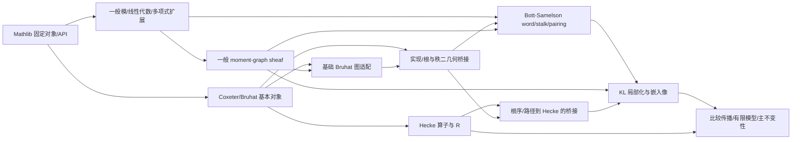

# KL 全库语义文件重构：设计、迁移与验收

本轮在独立实验 `experiments/kl-architecture` 实施全库文件重组，保留原有命题、证明和公开名字。它不是一轮新引理、通用 API 或 tactic 设计。状态和实际验收结果见末尾；不以既有基线通过代替本轮检查。

## 来源和范围

- 分支 `codex/kl-semantic-architecture`，起点为已合并 main `7ddc53ba8a09ed902fefff86e67a87217518c1d4`。
- 直接迁移参考为该提交的 `experiments/kl-kernel-transport`，继承两轮已完成的 signed-ranks / kernel-transport 成果。三个旧实验及根目录脚本、来源文件保持不变。
- pristine `experiments/kl` 的 34 个 blob 仍对应 upstream `adc7f1241b42e322a6451854ab7e4b4c146bf78a`，实验室运输快照为 `70211c3350c1f203aa8f52f1809e57d7ae93ba78`。本轮不是更新 upstream 源码。
- Lean `4.34.1`，commit `5045d0056413266e57c625dcd7c365b10e377c52`；Mathlib `d13f23b723b8a846827a245b89c10fc7d3f11612`。
- 只改 lean-lab。未修改其他仓库、saved environment 设置或权限；未推送、开 PR 或合并。本轮结果只代表本地云环境验收，没有 GitHub CI 结果。

## 1. 边界按数学对象和实际参数划分

判断原则是“声明描述谁、需要哪些数据、连接哪两个模型”，不是按某条长证明出现的先后顺序分类。保留旧 namespace，先把文件责任独立出来；namespace 重命名、替换现有结构和重新设计 API 留待后续。

以下路径均相对新实验的 `OAI/`。

| 语义归属 | 内容与边界 | 具体迁移例子 |
| --- | --- | --- |
| `Algebra/Module`, `LinearAlgebra`, `RingTheory`, `Data/Polynomial`, `Order` | Mathlib 对象上的现有本地补充：分次模、覆盖、核/像/商、换系数、配对、局部化、反射、对称代数商和多项式刚性；不依赖具体 Coxeter/KL 模型。 | `BottSamelson` 中的 `CoefficientChange.equivVal` → `Algebra/Module/CoefficientChange/Basic.lean`；`PlaneLocalization` 中的 `SymmetricPlaneIdeal.quotientEquiv` → `LinearAlgebra/SymmetricAlgebra/Quotient.lean`。 |
| `GroupTheory/Coxeter` | Bruhat/交换、实现与根、抛物子群和二面体几何对象；不导入表示论应用。 | `Model` 拆出 `Bruhat/Defs.lean`；`Tits` 的标准抛物包含和区间运输归 `Parabolic/Standard.lean`，KL 多项式包含结论另归 `KazhdanLusztig/Polynomials/Parabolic.lean`。 |
| `Combinatorics/DirectedPaths`, `Combinatorics/Dihedral` | 一般有向路径、schedule/transfer、排序，以及带符号二面体数值模型。 | `ReflectionSchedules` 的一般路径定义与 `DihedralIntervals` 的 signed-count 模型独立；其根坐标解释仍在 Coxeter 几何桥接文件中。 |
| `Combinatorics/MomentGraph` | 有序图上的模 sheaf、分次结构、同态、延拓、分解、嵌入像和配对。一般接口不依赖 Coxeter 或表示论；Bruhat 适配显式位于 `Bruhat/`。 | `CharacterReciprocity` 的 `LocalModels` / `ModelSum` → `Sheaf/Models.lean`；scaled-image 运输仍是 sheaf 对象的性质，不泛化成新类。 |
| `RepresentationTheory/Hecke` | 两种参数化的 Hecke 算子、普通 R、多项式和路径公式桥接。 | `Hecke` 中一般 `lowerFinset` 拆回 `Coxeter/Bruhat/LowerFinset.lean`；Dyer 路径与 Hecke 系数的桥接不放在纯根几何层。 |
| `RepresentationTheory/BottSamelson` | 具体 Tits 系数上的 word、坐标、stalk、配对、sheaf 桥接和 character。 | 通用线性下降、对偶直和和换系数已移出；具体 word 模型没有被伪装成新的通用抽象。 |
| `RepresentationTheory/KazhdanLusztig/{Polynomials,Sheaves,Localization,Comparison,Invariance}` | KL 规范、边界模型、局部化、比较传播与最终不变性。 | `Bruhat` 中的规范唯一性归 `Polynomials/Unique.lean`；`Invariance/FiniteModel.lean` 保留有限模型及其多项式匹配这一整体应用。 |

这不是完全分离所有数学责任：例如具体 Bott 配对仍需要坐标模型，几何局部化仍需要模型到 sheaf 的桥接。此次不为消除这些真实依赖而增加新接口。

## 2. 与固定 Mathlib 源码的具体对应

`M` 表示固定依赖 checkout 的 `Mathlib/`，`E` 表示新实验的 `OAI/`。这些是对象/API 锚点，不表示本轮将代码贡献给 Mathlib，也不声称其目录树与 Mathlib 完全相同。

| 固定 Mathlib 锚点 | 本地责任 / 新文件 | 采用与未采用的设计 |
| --- | --- | --- |
| `M/Algebra/Module/GradedModule.lean:17` 的 `DirectSum.Decomposition`、`SetLike.GradedSMul` 组织 | `E/Algebra/Module/Graded/Components.lean`、`Generators.lean`、`ModuleData/Basic.lean:16` | 现有 `Graded.ModuleData` 继续封装这些数据，不改成新 typeclass，也不重新证明同构。 |
| `M/LinearAlgebra/Reflection.lean:101` 的 `Module.reflection` | `E/LinearAlgebra/Reflection/Plane.lean:13` 的 `ReflectionPlane.formPair_surjective`，以及 Forms / NondegenerateExtension | 任意线性空间上的反射性质归线性代数；具体 Tits 实现归 Coxeter。 |
| `M/LinearAlgebra/SymmetricAlgebra/Basic.lean:99` 的 `SymmetricAlgebra.lift` | `E/LinearAlgebra/SymmetricAlgebra/Quotient.lean:54` 的 `SymmetricPlaneIdeal.quotientEquiv` | 原命题实为任意子空间的对称代数商等价，没有“二维平面”假设；文件归属据签名判断，名字暂保留兼容。 |
| `M/Algebra/Module/LocalizedModule/Submodule.lean:99,241,308` 的 localized submodule / quotient API | `E/Algebra/Module/Localization/{Lattice,Membership,Products,FiniteCharacters,ProjectiveLattice}.lean` | 一般局部成员判别与具体根/边局部化分离；不改本地定理接口。 |
| `M/Algebra/Module/Submodule/Ker.lean:85,329` 的 `LinearMap.ker_comp`、`LinearEquiv.ker_comp` | 已有 `E/LinearAlgebra/KernelTransport.lean` | 前一轮独立 kernel API 原样保留；本轮不重复设计。 |
| `M/Algebra/Polynomial/Reverse.lean:88` 的 `Polynomial.reflect` | `E/Data/Polynomial/{LowPart,ReflectEvaluation,ReciprocalRigidity}.lean` | 多项式操作/刚性本身不需 Coxeter 数据；具体 KL 递归和规范留在表示论层。 |

Moment-graph sheaf 仍是有序图上的顶点/边模与线性映射；它没有 Mathlib 拓扑/站点 sheaf 所需的数据，所以没有把它强行搬成 `SheafOfModules`。

## 3. combkl 知识结构提供阅读责任，不提供 import 权威

阅读固定的 documentation-only pin `8004f18a6cab3bb1f113b48abb5d2ea4c37bcaaf`：

- [`docs/planning/knowledge-base-relationships.md`](https://github.com/jiajunma/combkl/blob/8004f18a6cab3bb1f113b48abb5d2ea4c37bcaaf/docs/planning/knowledge-base-relationships.md)
- [`docs/planning/knowledge-base-relations.json`](https://github.com/jiajunma/combkl/blob/8004f18a6cab3bb1f113b48abb5d2ea4c37bcaaf/docs/planning/knowledge-base-relations.json)
- `docs/knowledge/{README.md,concept-links.yml,source-comparisons.yml}`。

其元数据明确说是 exposition interfaces，不是模块 import 图或完整 Lean 声明依赖图；所指 combkl code revision 是 `108243e05ed46235bf82dc30d4d90c794579776f`，upstream 与实验室相同。实验室仍以自己核验的 source blobs 为准，没有整体同步文档或代码。

| KB stage / 主题 | 此次文件责任的对应与必要区别 |
| --- | --- |
| `c` Coxeter intervals；`cf` finite-support transport | 基本区间归 `GroupTheory/Coxeter/Bruhat`；带 KL 多项式结论的 finite model 归 `Invariance/FiniteModel`，不因阅读主题相邻而混放。 |
| `r` realizations / roots；`oo,og,on` root orders / dihedral / counts | 分开一般线性反射、具体实现/根、signed 数值模型和模型到根几何的桥接。 |
| `a` general graded algebra；`ra` root-labelled coefficient algebra | 一般模/商/局部化/换系数留在对象扩展层；具体 root label 和系数模型在 Coxeter/Bott/KL 桥接层。 |
| `s,sb,ss,sd` general / boundary / splitting / decomposition sheaves | 一般 sheaf、boundary、分次同态与 split/image 按对象组织；Bruhat 边界 sheaf 单列，不将所有 sheaf 文件串到 Hecke 或 Bott 之后。 |
| `w,we,wc,ws,sp,sc` word modules / coordinates / characters / support | 具体 word 模型归 Bott；一般配对、伴随、下降与支撑对偶先移到线性代数或分次模层。 |
| `os,op,ot,od,om` schedules / Dyer / transported matrices | 一般列表与 transfer 不依赖根；路径到 Hecke 的比较桥接归 `Hecke/DyerPaths`。 |
| `l0,lm,lf,li,lg` localized models / factors / embedded images | 一般 symmetric-algebra quotient、flat kernel、sheaf `ScaledImages` 各归自己的对象；具体 coset/plane/edge 的组合留在 KL Localization。 |
| `i1`–`i7` inequality / induction / invariance | 一般数值 rigidity 与实际边界比较分开；最后的 finite/unrestricted 运输保持在 Invariance。 |

实际 imports 由固定已编译源码中的声明类型、证明常量引用及 elaborator references 核查。编译器跨声明复用的内部 proof 常量会展开到实际依赖，不能误当作“通用矩阵理论需要 Bott word”的数学依赖。最后还要靠重新编译和独立 import harness 验证。

## 4. 迁移方法和可恢复性

- 525 个既有完整源码单元组合成 193 个实现文件；通常移动闭合 namespace/section。少数混合 scope 只在原有完整声明之间切开，复制其变量/namespace 上下文，未拆任何证明。
- 原有命题与证明正文逐字运输；76 个既有匿名实例添加原有完整名称，避免换文件后计数名称变化。分离的 Hecke inverse scope 重新启用原有 local instance 属性，实例值不变。
- `migration.json` 固定原文件哈希、起止行、单元正文哈希、上下文、实例名称注释和直接 imports。`migrate.py --check` 对照确定性生成结果检查；`source_check.py` 另外检查 34 个参考文件全部 35,871 行非注释代码的覆盖。
- 原来 34 个 KL 路径成为 import-only 兼容入口；两个前轮 kernel 模块原样保留。新实现不反向依赖这些兼容入口。`OAI.Architecture` 聚合全部实现，避免未被主定理消费的旧导出漏验。
- 原有公开 namespace 暂保留，包括 `OAI.KLInvariance.*`。这是兼容性选择，不应把“文件独立”误读成 namespace/API 已经完全通用化。
- 原有实验和严格验证器均未改，包括之前的 31-field 比较政策。新实验采用另行说明的数学类型比较，并保留自己的检查工具。

## 5. 193 个文件是否过碎

193 不包含 34 个旧入口、两个稳定 kernel 文件和一个聚合入口；全部 OAI 文件数为 230。实现文件物理行数含 imports/复制的 scope/注释：合计 43,202 行，中位数 135，范围 23–1,331；14 个不足 40 行，37 个不足 60 行，71 个不足 100 行。

结论是：**整体已按可识别对象组织，但存在偏细的叶文件；193 不是经优化证明的最优粒度。** 本轮优先保住完整原单元、独立 import 边界和兼容性，没有为凑文件数新增抽象。相同责任只在不造成依赖环时合并，已经把 525 个单元合并到 193 个文件。

薄文件不都意味着应合并：

- `Bruhat/LowerFinset.lean` 31 行，有四个语义实现直接消费者；把它放回 Hecke 会恢复明确的反向责任依赖。
- `Invariance/Main.lean` 38 行是稳定的主定理入口，单独保留合理。
- `Data/Polynomial/ReflectEvaluation.lean` 27 行、`LinearAlgebra/Descent.lean` 37 行等只有一个直接实现消费者，保留单文件的收益较弱；可在独立架构审阅时评估与相同对象文件合并。
- `Algebra/Module/Submodule/ScaledImage.lean` 37 行，没有生产实现消费者，保留是为了不删除既有公开 API，不能宣传成新增的跨模块复用成果。

文件数增加也有成本：导航项、imports 和冷编译进程更多。各实现仍宽导入 Mathlib；本轮没有优化 Mathlib 导入、证明复杂度或证明长度。不能宣称文件数越多越好，也不能由 warm build 推断冷编译或交互体验加速。暂不为减少目录项再次移动已缓存的长证明；193 个文件作为这一独立实验的可审阅方案保留，后续合并同对象叶文件无需设计新引理。

## 6. 是否真正减少跨责任依赖

并不声称“总边数减少”：原 36-module core 的直接 OAI imports 是 38 条，新 195-module core 是 325 条，拆文件后绝对边数不可直接当作耦合指标。

可验证的收益是具体对象不再被迫导入无关应用。下面闭包均只计 OAI 模块，包含入口自身，不计 Mathlib；旧入口较大，因此这些数说明暴露面/责任分离，不是性能基准：

| 要使用的现有数学内容 | 旧文件入口的 OAI 闭包 | 新入口的 OAI 闭包 |
| --- | ---: | ---: |
| `CoefficientChange` 基础运输，原 BottSamelson | 23 | 1：`Algebra/Module/CoefficientChange/Basic` |
| 一般 `LocalModels` / `ModelSum`，原 CharacterReciprocity | 27 | 12：`Combinatorics/MomentGraph/Sheaf/Models`；全部为一般模/sheaf |
| Tits 实现，原 Tits | 10 | 3：`GroupTheory/Coxeter/Realization/Tits`；无表示论应用 |
| 多项式 low-part，原 CanonicalKL | 6 | 1：`Data/Polynomial/LowPart` |
| 对称代数子空间商等价，原 PlaneLocalization | 31 | 1：`LinearAlgebra/SymmetricAlgebra/Quotient` |

静态约束同时检查：基础对象层无具体 Coxeter/sheaf/表示论依赖；一般 moment-graph sheaf 无 Coxeter/表示论依赖；Coxeter 对象层无表示论依赖。`ImportChecks.lean` 和 `DomainImportChecks.lean` 在新环境中实际导入代表性对象层并检查模块集合，而不是仅检查路径字符串。旧入口保留旧导入暴露面；只有改用新语义入口才能获得这种分离。

完整可重现数据在 `architecture-metrics.json`，分析命令 `python3 experiments/kl-architecture/analyze.py`。

## 7. 架构图与完整索引

下面是按构造阶段折叠的阅读图。箭头表示存在从被使用对象到消费者的依赖，不表示目标中的每个文件都依赖所有前驱；具体 DAG 以完整图和清单为准。



- `experiments/kl-architecture/MIGRATION.md`：全部 34 个旧文件到新文件的逐段行号索引，以及每个实现的直接 OAI imports。
- `DEPENDENCIES.dot` / `DEPENDENCIES.svg`：完整 195-node core 图，箭头为 imported module → consumer；不把兼容入口混入 core。
- `migration.json`：可重放的精确迁移记录。`analyze.py` 重建 DOT 与粒度/闭包统计；有 Graphviz 时 `dot -Tsvg DEPENDENCIES.dot -o DEPENDENCIES.svg` 重绘图。

## 8. 验收记录

本轮验收完成。当前数学源码的全库构建成功；随后 `--checks-only --refresh-reference` 再要求全部缓存就绪，顺序跑完所有验收及 warm repeat。以下均为本地实际执行结果。

### 通过的范围

| 检查 | 结果 |
| --- | --- |
| pristine 身份、依赖与工具链 pins | 34 个原始 source blobs 匹配；所有旧实验/根脚本/provenance 无差异 |
| 源码迁移与覆盖 | 全部 230 个 OAI 产品匹配重放；34 文件、525 单元、35,871 非注释行被覆盖 |
| 导入图 | 有向无环、实现不导入旧 shim；三个对象层方向约束通过 |
| 全库编译 | `lake build OAI` 成功，9154 jobs；包含新实现、两个稳定模块、全部旧兼容入口和主定理 |
| 实际独立 imports | `ImportChecks.lean`、`DomainImportChecks.lean` 均通过，确认一般对象不带入具体应用 |
| 继承的行为检查 | KernelChecks、CompatChecks、signed BoundaryChecks 均通过，旧测试未删改 |
| 公理闭包 | 16 个目标全部在允许集合内；主定理 `OAI.KLInvariance.combinatorial_invariance` 恰为 `propext`、`Classical.choice`、`Quot.sound` |
| 公开接口 | 3902 → 3902；无缺失、新增或规范化数学类型/种类/宇宙/公开 binder 隐显性差异；3896 个声明改变模块归属 |
| 比较器反例测试 | 14 项通过，含 proof-proposition 变化和共享 DAG 的作用域泄漏反例 |
| 参考类型快照 | 用最终同一导出器在 warm 参考环境重新导出，核对通过，不凭旧快照直接判新代码通过 |
| warm repeat | `lake build OAI` 成功，3.565 秒 |

### 类型比较的精确定义与实际发现

不能将本次结果叫作“原始序列化字段完全相同”。只去除 binder 显示名与私有 owner 前缀的初版比较仍失败：785 个公开类型引用了换文件后改名的内部 `_proof_` 定理；一个内部 proof 命题的 binder 元数据也不同。另有 `rankDifference.eq_1` 被两个导入分支重复序列化，原始导出行数为 3903，但全局公开名字仍为 3902。这些失败与诊断保留在 evidence 中。

最终规则不维护声明/字段例外清单：

1. 导出 Lean 全局环境中的唯一公开声明。遇到模块序列化副本，要求类型、宇宙参数、种类和 value 全部相同，记录副本后只导出全局声明；冲突仍失败。实际仅发现一个相同副本。
2. 所有数学表达式构造、常量、宇宙、de Bruijn 索引及公开 binder 的隐显性保持比较；binder 显示名和 mdata 不参与数学类型比较。私有 OAI owner 前缀只做单射映射，重名冲突会失败。
3. 仅当名字是 OAI 内部 `_proof_` 辅助、且其 `ConstantInfo` 是经过 Lean 内核导入的 theorem，才用其完整命题表示该 proof 引用。依据是内核 proof irrelevance；不是展开证明正文或任意定义。命题内部的 binder 显示/隐显性是该内部证明的 elaboration 元数据，可忽略；公开类型其余 binder 信息不忽略。
4. 普通用户定理、定义、数据实例都不折叠。proof 命题中的常量、参数和表达式结构仍比较，所以换命题不会被放过。两个独立 Expr 缓存按“公开类型 / 编译器 proof 命题”区分；Python DAG 检查也以 `(node, context)` 检查共享节点，禁止 `kernel` binder 标记流出 proof 作用域。

最终参考/新环境分别使用 141/153 个这种内部 proof 辅助；不要求编译器的共享方式相同。最终类型对照在上述一般规则下完全通过。旧实验的严格 31-field 比较器没有修改。该验收仍依赖本轮导出器/比较器的正确性，完整代码与反例测试随审阅包提供；本轮尚未获得独立审查，也不对 upstream 原数学论证作独立认证。

### 耗时和缓存边界

全库完成调用耗时 **142.128 秒**，复用了先前探索和长证明构建产物，不能称为从零冷编译时间。以下为随后最终完整验收的各阶段 wall time（秒）；完整命令、CPU 时间和累计子进程 RSS high-water 在 evidence JSON 中。

| 阶段 | Wall 秒 | 退出状态 |
| --- | ---: | ---: |
| `frozen-tree` | 0.002 | 0 |
| `baseline-identity` | 0.335 | 0 |
| `source-transport` | 0.198 | 0 |
| `source-coverage` | 0.359 | 0 |
| `lean-version` | 0.752 | 0 |
| `mathlib-ready` | 2.966 | 0 |
| `oai-ready` | 3.474 | 0 |
| `ImportChecks` | 4.402 | 0 |
| `DomainImportChecks` | 4.520 | 0 |
| `KernelChecks` | 5.103 | 0 |
| `CompatChecks` | 4.879 | 0 |
| `BoundaryChecks` | 5.228 | 0 |
| `Audit` | 4.007 | 0 |
| `reference-ready` | 3.232 | 0 |
| `reference-types` | 9.185 | 0 |
| `reference-snapshot-check` | 2.499 | 0 |
| `migrated-types` | 9.013 | 0 |
| `type-comparison` | 2.432 | 0 |
| `comparator-tests` | 0.060 | 0 |
| `warm-build` | 3.565 | 0 |

- 新实验 Mathlib cache preflight 在编译前通过；没有全量 Mathlib 源码构建。新实验共享精确依赖 checkout，OAI 编译产物独立。
- 原有长证明本轮确实重新编译：Bott stalk 约 150 秒，pairing 约 720 秒，均为 Lake 显示值并包含 compiler-lock 排队时间；不当作直接 elaboration benchmark。最终验收复用了这些产物，没有再次冷编译它们。
- 为适应 16 GiB worker，runner 的本地 per-run compiler lock 序列化 Lean 进程；不改系统安装或 saved setting。Mathlib cache 缺失时先失败，不自动转入其源码全编译。
- 早期广泛构建出现 section/comment 边界、匿名实例命名、局部实例属性和集成重建期间缺少 diamond artifact 的失败；最终顺序构建全部消除。探索调用有主动中断和时间重叠，历史 wall time 不能相加当总冷编译时间。
- 一个后来弃用的“逐类型展开辅助证明并检查”的导出器探针触发默认 heartbeat 限制，另有冗余导出器探针被停止；最终改为不展开 proof body 的命题表示，未提高任何证明或验收 heartbeat 限制，最终导出各约 9 秒。
- 新架构的冷构建进程数更多，未来维护成本不一定整体下降。没有速度提升或统计显著性的结论。

### 复现与交付

从 lab 根目录：

```bash
bash scripts/setup.sh
bash experiments/kl-architecture/check.sh
```

正常 runner 以固定源码和导出器哈希绑定的参考类型快照避免 fresh worker 为比较而编译两份库。有旧参考缓存时，可像本轮最终验收一样要求它独立重导出：

```bash
bash experiments/kl-architecture/check.sh --checks-only --refresh-reference
```

轻量结构检查为 `bash experiments/kl-architecture/check.sh --static`。常规使用不需要 Graphviz；只有重绘 SVG 才需要它。

提交中的 `reports/evidence/architecture-*` 保存最终阶段结果、公理日志、公开类型对照、比较器测试、构建历史和原始失败诊断。逐文件迁移索引、精确重放清单及完整 core 图随实验保存。历史 checkpoint 文档只记录当时状态，最终状态以本报告和 acceptance evidence 为准。
